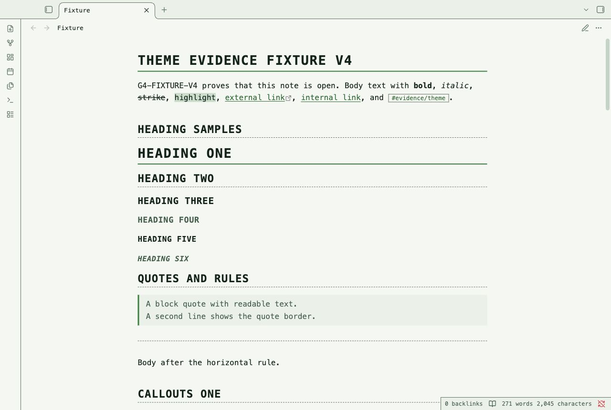
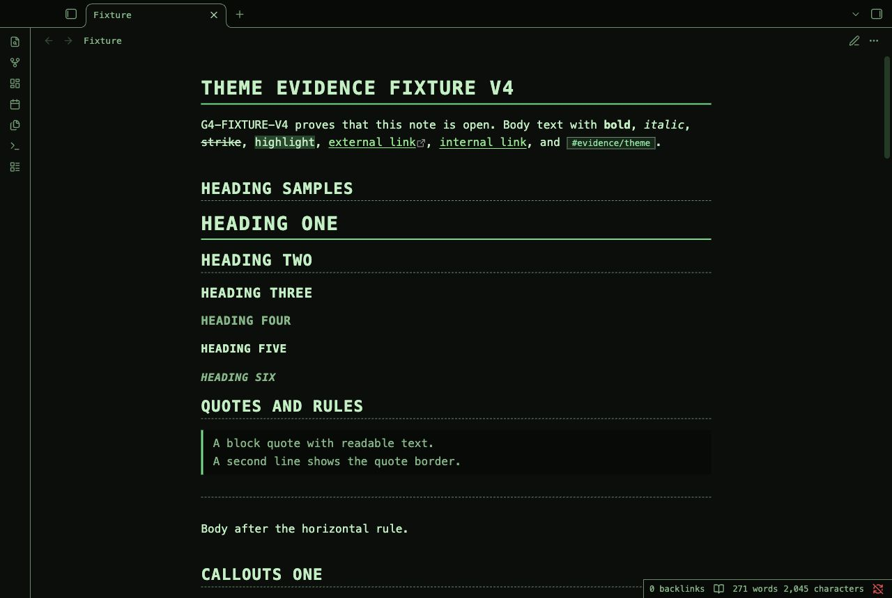
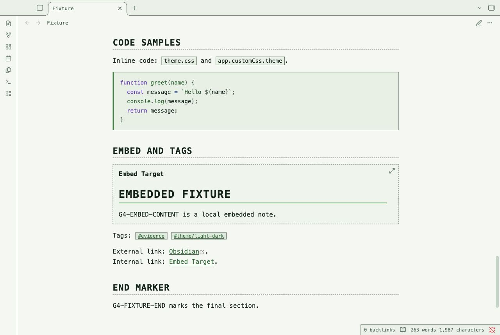
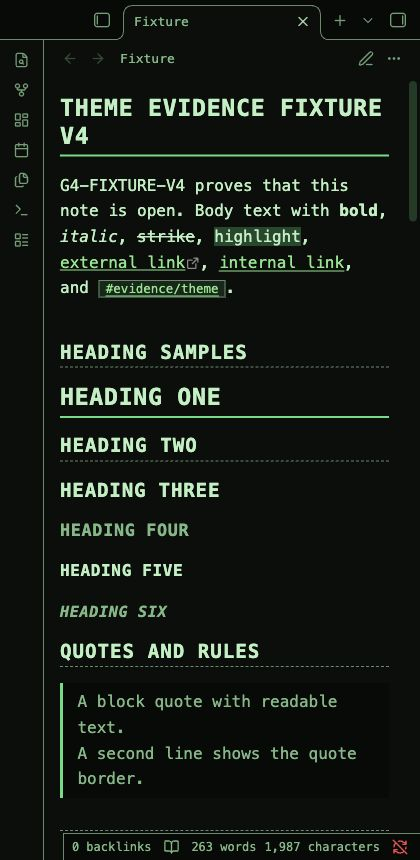

# Terminal Notes

Terminal Notes is an Obsidian theme for command references, shell logs, and technical notes.
Monospace text, square controls, and dashed rules give the page a terminal structure.
Dark mode uses phosphor green on near-black. Light mode uses dark green on pale paper.
Typed callout frames keep status labels and icons visible. Grid tables suit command and status records.
Code blocks use a continuous green rail. Selected commands use an inverse cursor bar.

## Screenshots

These images show the desktop renderer with a test note.






## Install

1. Download `theme.css` and `manifest.json` from this repository.
2. Open your vault folder.
3. Create the folder `.obsidian/themes/Terminal Notes/`.
4. Put both files in that folder.
5. Open Settings, then Appearance in Obsidian.
6. Select **Terminal Notes** in the theme list.

Use the manifest name for the install folder. The repository name is not the install folder name.

## Uninstall

1. Select the default theme in Settings, then Appearance.
2. Remove `.obsidian/themes/Terminal Notes/` from the vault.

The theme does not change note text.

## Compatibility

The manifest requires Obsidian 1.1.0 or later.
The desktop renderer was tested with Obsidian 1.14.4.
Mobile use was not tested. A narrow desktop capture does not test a mobile device.
Community plugin views and screen readers were not tested.

## Customization

Add a CSS snippet in Settings, then Appearance to override theme variables.
For example, this snippet gives technical notes more reading width:

```css
body {
  --file-line-width: 84ch;
  --line-height-normal: 1.7;
}
```

The core Accent color control changes terminal rails, selection bars, and control accents.
The `--term-accent` variable overrides that accent in a CSS snippet.
Callout status colors and link inks remain separate.
The `--term-bg`, `--term-ink`, and `--term-rule` variables control backgrounds, text, and borders.
Set these variables under `.theme-light` or `.theme-dark` in your snippet.
Check contrast after a color change.
This theme does not include Style Settings controls.

## Known limits

- Monospace text fits fewer characters across narrow panes than most proportional fonts.
- Headings, callout titles, and table headers use uppercase letters. Tags keep their case. This can change the appearance of case-sensitive identifiers.
- Long code lines and wide tables can require horizontal scrolling.
- The theme presents command notes. It does not execute commands or add a terminal.
- Accent changes can reduce contrast. Check selected text and focus after a color change.
- Color mixing uses the current desktop renderer. The oldest declared app version was not tested.
- The native ribbon, tab headers, status bar, and file list were not reached by the Tab trace in Obsidian 1.14.4.
- The editor shows focus with an ink rail and a clear caret.
- System monospace fonts differ between operating systems. Line wraps can change with the font.

## License

[MIT License](LICENSE). Copyright (c) 2026 NoteMods.
NoteMods maintains this theme.
